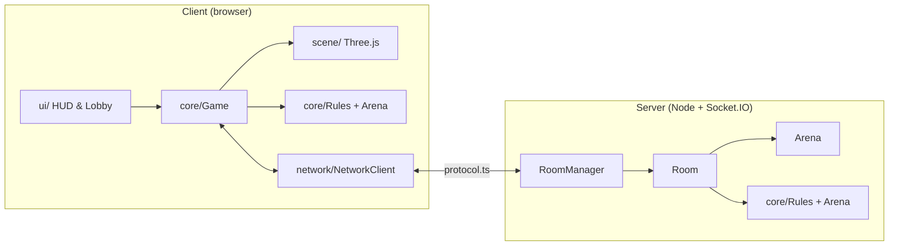

<div align="center">

# 🎲 Ular Tangga 3D

**Ular tangga klasik, versi 3D di browser — lawan komputer, main online 2–4 pemain, ditonton live, lengkap dengan Mode Arena dan Duel.**


[Mulai Cepat](#-mulai-cepat) · [Fitur](#-fitur-utama) · [Cara Main](#-cara-main) · [Online](#-multiplayer-online) · [Arena](#%EF%B8%8F-mode-arena) · [Duel](#-duel-fight) · [Arsitektur](#%EF%B8%8F-arsitektur)

</div>

---

## ✨ Fitur Utama

| | |
|---|---|
| 🤖 **Vs Komputer** | 1–3 bot dengan kepribadian dan emote sendiri. Simpan & lanjutkan per giliran. |
| 🌐 **Multiplayer Online** | Room dengan kode 6 karakter, 2–4 pemain, server *authoritative*, sambung ulang otomatis. |
| 📺 **Live & Penonton** | Tonton room yang sedang bermain, live chat, daftar penonton, 8 ekspresi dengan SFX. |
| ⚔️ **Mode Arena** | Darah, perisai, tas 3 slot, 12 item acak di papan, 12 senjata dengan jarak serang berbeda. |
| 🥊 **Duel (Fight)** | Berhenti di petak lawan → duel ritme ala *Ayo Dance*, 6 ronde, yang kalah kembali ke Start. |
| 🎵 **Audio Sintetis** | Musik & SFX dibangkitkan WebAudio — tanpa satu pun file audio. |
| 🎥 **Sinematik** | Kamera mengikuti pion, confetti, kembang api, bloom, hit-stop, podium juara 3D. |
| ♿ **Ramah Pengguna** | Bahasa ID/EN, kontras tinggi, kurangi gerakan, kualitas grafis otomatis. |

---

## 🚀 Mulai Cepat

```bash
npm install
npm run dev:all
```

Buka `http://localhost:5173`. Perintah di atas menjalankan client **dan** server multiplayer sekaligus — perangkat lain di jaringan yang sama bisa ikut main lewat `http://<IP-PC>:5173`.

### Perintah

| Perintah | Fungsi |
|---|---|
| `npm run dev` | Client saja (Vite). Tambahkan `?speed=4` di URL untuk mempercepat animasi saat uji. |
| `npm run dev:all` | Client + server multiplayer; client bisa diakses dari HP lewat IP LAN. |
| `npm run server` | Server multiplayer saja (port `3001`, ubah dengan `PORT=...`). |
| `npm start` | Build client, lalu server menyajikan client + soket di satu port — cocok untuk LAN/hosting. |
| `npm run build` | `tsc --noEmit && vite build` |
| `npm test` | Vitest — aturan permainan + integrasi server multiplayer. |
| `npm run lint` | ESLint |
| `npm run format` | Prettier |

---

## 🎮 Cara Main

Capai petak **100** lebih dulu. Tangga membawa naik, ular membawa turun.

### Aturan dasar

- Papan 10×10 zig-zag dengan 4 preset: **Mudah**, **Normal**, **Kacau**, dan **Acak** (tervalidasi).
- Angka **6** = lempar lagi (maks. 3×; 6 ketiga beruntun membuat giliran hangus).
- Harus mendarat **pas** di 100 — kelebihan langkah memantul mundur.
- Kedua aturan di atas bisa dimatikan saat setup.

### Lempar dadu: tahan & lepas

Tahan tombol lempar — bar tenaga terisi dalam 1,8 detik. Lepaskan di **zona hijau (≥ 88%)** untuk **lemparan sempurna**: dua dadu dilempar dan diambil yang terbesar, sehingga peluang angka 6 naik dari **16,7% → 30,6%**. Menahan terlalu lama setelah penuh membuat tenaga hangus dan lemparan jadi biasa. Bot selalu melempar biasa.

### Kontrol

| Tombol | Aksi |
|---|---|
| `Spasi` / `Enter` (tahan, lepas) | Lempar dadu |
| `1` – `8` | Ekspresi: tepuk tangan, tertawa, teriak, horee, wow, huuu, menangis, muah |
| `Esc` / `P` | Jeda / menu |
| `Esc` saat membidik | Batal memakai item Arena |
| `↑ ↓ ← →` / `W A S D` | Mengetik urutan panah saat Duel |
| `Spasi` | *HIT* saat Duel |

### Karakter

🐱 Kiko · 🐻 Bobo · 🐧 Pipi · 🤖 Rara · 🦖 Dino · 🐰 Mimi

Enam karakter prosedural dengan animasi *idle*, *hop*, *climb*, *scared*, *cheer*, dan *sad*. Di room online setiap pemain memakai karakter yang berbeda.

---

## 🌐 Multiplayer Online

1. Menu **Main Online** → **Buat Room** untuk mendapat kode 6 karakter (bisa disalin sebagai kode atau link `?room=KODE`), atau **Gabung** dengan kode.
2. Setiap pemain memilih karakter, non-host menekan **Siap**.
3. Host mengatur papan, aturan, Mode Arena, dan Duel, lalu menekan **Mulai**.

**Server authoritative** — RNG dadu dan validasi giliran ada di [`server/Room.ts`](server/Room.ts). Client hanya mengirim `roll`; lemparan sempurna dinilai server dari selisih waktu `charge_start` → `roll`. Client mereplikasi aturan dari hasil server dan selalu mengikuti server bila berbeda.

| Situasi | Perilaku |
|---|---|
| Pemain AFK | Giliran 25 detik (+ waktu animasi), lalu dadu dilempar otomatis. |
| Koneksi putus / refresh / tab ditutup | Client menyambung ulang otomatis dengan token sesi (`localStorage`, 30 menit sejak aktivitas terakhir) dan menerima snapshot state. |
| Pemain terputus saat bermain | Masa tenggang 45 detik, setelah itu gilirannya dimainkan otomatis. |
| Pemain terputus di lobby | Slot dilepas setelah 20 detik. |
| Tab di latar belakang | Game tetap berjalan di server; saat tab aktif lagi client meminta `sync` dan melompat ke keadaan terkini. |
| Host keluar | Host berpindah ke pemain berikutnya. |
| Host mengeluarkan pemain (*Kick*) | Tombol *Keluarkan* (klik 2× untuk konfirmasi) di lobby dan di menu `Esc` saat bermain. |
| Pemain di-kick / keluar saat bermain | Pion diangkat, slot terbuka untuk pemain baru (mulai dari Start, giliran paling akhir). |
| Tinggal 1 pemain | Permainan **menunggu** sampai ada yang bergabung; kode room tampil di HUD. |
| Room kosong | Dihapus setelah 60 detik. |

### 📺 Live, Penonton & Chat

- Tonton lewat menu **Tonton Live**, daftar **Live sekarang** di lobby, kode room, atau link `?watch=KODE`. Nama wajib diisi (divalidasi juga di server).
- Penonton bisa masuk kapan saja — lobby, saat bermain, atau setelah selesai — dan langsung mendapat snapshot, termasuk duel yang sedang berjalan.
- **Live chat** di kiri bawah untuk pemain dan penonton: riwayat 50 pesan, batas 5 pesan / 5 detik, umpan kejadian permainan (tangga, ular, angka 6), dan badge pesan belum dibaca saat diciutkan.
- **Ekspresi** pemain tampil di atas pion dan di kartu HUD; ekspresi penonton melayang di atas chat dengan SFX yang lebih pelan.

---

## ⚔️ Mode Arena

Opsi host di lobby — **aktif secara default**. Matikan untuk permainan ular tangga biasa.

Setiap pemain mulai dengan **❤️ 100 darah**, **🛡️ perisai 60**, dan tas **3 slot** berisi **1 senjata acak**.

### Item di papan

- **12 item** acak (berbobot) tersebar di petak yang berjauhan — bukan petak 1/100, tangga, ular, atau petak berisi pion.
- Pion yang **berhenti** di petak ber-item mengambilnya bila tas belum penuh (tas penuh = item tetap di papan).
- Item yang diambil muncul lagi **15 detik** kemudian di petak acak, dan **seluruh item diacak ulang tiap 2 menit** (hitung mundur 🔀 di tas).

### Senjata

Jarak = selisih nomor petak. Serangan hanya **1× per lemparan**, pada giliran sendiri, sebelum melempar. Start tidak bisa diserang.

| Senjata | Jarak | Damage | | Senjata | Jarak | Damage |
|---|:-:|:-:|---|---|:-:|:-:|
| 🥊 Tinju | 1 | −20 | | 🪃 Bumerang | ≤ 4 | −25 |
| 🔨 Palu | 1 | −35 | | ❄️ Bola Salju | ≤ 5 | −15 |
| 🔥 Semburan Api | ≤ 2 | −30 | | 🏹 Panah | ≤ 6 | −25 |
| 🧨 Dinamit | ≤ 2 | −50 | | ⚡ Petir | ≤ 8 | −20 *(tembus perisai)* |
| 💣 Bom | ≤ 3 | −40 | | 🚀 Roket | 2 – 12 | −30 |
| 🛸 Sinar UFO | bebas | −25 | | ☄️ Meteor | bebas | −40 |

### Bertahan & pemulihan

| Item | Efek |
|---|---|
| 🛡️ Perisai | Meter daya tahan yang selalu aktif: menyerap **separuh** damage tiap serangan sampai habis. Diambil dari papan = +60 (maks. 100), tidak memakai slot tas. |
| 🪞 Cermin | Memantulkan 1 serangan ke penyerang. |
| 🍎 Apel | +20 darah |
| 🧪 Ramuan | +40 darah |

Darah habis → **K.O.**, pion melambung kembali ke **Start** dengan darah penuh.

### Efek serangan

Kamera menyorot sasaran, proyektil sesuai gaya senjata, *hit-stop* sesaat, ledakan dengan gelombang kejut, pion terpental, teks komik besar (**POW! · BOOM! · KABOOM! · ZZZAP!**), kilat layar, dan SFX berlapis — teriakan penyerang, suara lepas & kena per senjata, *"Ooooh!"* penonton. Angka darah di HUD baru turun saat serangan benar-benar mengenai.

> Logika Arena berjalan di server ([`server/Arena.ts`](server/Arena.ts)) dengan aturan bersama di [`src/core/Arena.ts`](src/core/Arena.ts). Duel di petak yang sama tetap berlaku.

---

## 🥊 Duel (Fight)

Opsi host di lobby — **mati secara default**. Pion yang berhenti di petak yang sudah ditempati pemain lain (setelah ular/tangga; Start tidak dihitung) memicu duel ritme di layar tiap petarung.

1. Hitung mundur **3 – 2 – 1 – FIGHT!**, lalu **6 ronde** dengan urutan 4 → 8 panah.
2. Ketik urutan panah (`↑↓←→`, `WASD`, atau tombol layar). Salah satu panah = ulang dari awal.
3. Tekan `Spasi` / **HIT** saat kursor ketukan berada di zona: **PERFECT · GREAT · COOL · BAD**. Lewat zona atau terlalu cepat = **MISS** dan combo putus.

**Damage** = (10 + 2 × jumlah panah) × nilai × combo (+10% per ronde beruntun, maks. +50%) ke semua lawan, dari HP 100. K.O. atau ronde habis → HP tertinggi menang (seri: damage terbanyak, lalu penghuni petak); yang kalah kembali ke Start.

Pemain lain dan penonton menonton duel **live**: ketikan panah tiap petarung, HP, nilai, combo, dan kamera 3D yang menyorot petak duel.

---

## 🏗️ Arsitektur

```
snake-ladder/
├── server/              # Server Socket.IO (authoritative)
│   ├── index.ts         #   HTTP + soket, menyajikan build client
│   ├── RoomManager.ts   #   daftar room, live list
│   ├── Room.ts          #   giliran, dadu, chat, penonton, duel, kick, sambung ulang
│   └── Arena.ts         #   darah, item, serangan
├── src/
│   ├── core/            # Logika murni tanpa Three.js
│   │   ├── Rules.ts  GameState.ts  Arena.ts
│   │   └── Game.ts  StateMachine.ts  EventBus.ts
│   ├── scene/           # Three.js: papan, ular, tangga, dadu, karakter, kamera, efek
│   ├── players/         # HumanController, AIController
│   ├── network/         # NetworkClient + protocol.ts (pesan bersama client/server)
│   ├── ui/              # HUD, Lobby, Chat, FightOverlay, menu, modal
│   ├── audio/           # AudioManager — musik & SFX sintetis WebAudio
│   └── i18n/            # id.json, en.json
└── tests/               # rules.test.ts, server.test.ts
```



Aturan permainan (`Rules.ts`, `GameState.ts`, `Arena.ts`) bebas dari Three.js sehingga dipakai bersama oleh client dan server, serta mudah diuji.

---

## ⚙️ Konfigurasi

| Variabel | Lokasi | Keterangan |
|---|---|---|
| `PORT` | server | Port server (default `3001`). |
| `CLIENT_ORIGIN` | server | Origin yang diizinkan CORS, pisahkan dengan koma. |
| `VITE_SERVER_URL` | client | URL server bila berbeda origin dengan client. |

Saat `npm run dev`, path `/socket.io` di-proxy ke `localhost:3001`.

---

## ⚡ Performa

Beban terbesar ada di GPU (resolusi/fill-rate, bloom, bayangan) — logika game hanya ±0,25 ms/frame. Karena itu:

- Pixel ratio dibatasi 1,5, bloom di setengah resolusi, shadow map 1024, MSAA kanvas dimatikan, partikel tidur saat tidak dipakai.
- Kualitas **Otomatis** memantau FPS dan bertahap menurunkan resolusi → mematikan bloom → mematikan bayangan.
- Pilihan manual di **Pengaturan → Kualitas**: Otomatis / Tinggi / Sedang / Rendah.

---

## 🧪 Pengujian

```bash
npm test
```

69 tes Vitest:

- **`rules.test.ts`** — gerak & pantulan di 100, tangga/ular, aturan 6, validasi semua preset papan, simulasi permainan penuh, lemparan sempurna.
- **`server.test.ts`** — room & lobby, game 4 pemain penuh (simulasi client = server), AFK, sambung ulang, ekspresi, penonton & chat, kick, duel, dan Mode Arena.

---

## 📝 Catatan

Spesifikasi lengkap ada di [snake-ladder-3d-spec.md](./snake-ladder-3d-spec.md). Perbedaan dari spek:

- **Howler.js** dan **cannon-es** tidak dipakai — audio disintesis WebAudio, animasi dadu memakai GSAP.
- Pemenang ditentukan saat pemain pertama tiba di 100; peringkat lain berdasarkan posisi saat itu.
- Model GLB belum ada — karakter masih prosedural.

### Rencana

- [ ] Mode hot-seat (beberapa pemain di satu perangkat)
- [ ] Model karakter GLB
